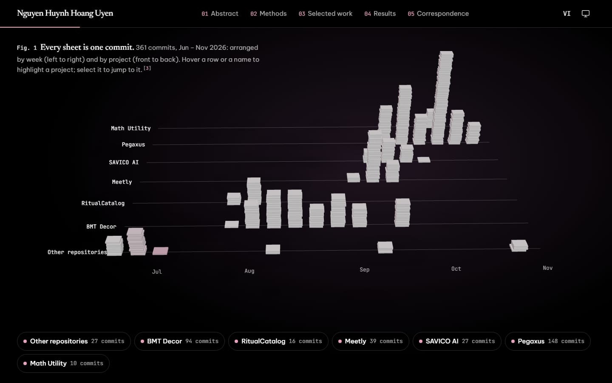
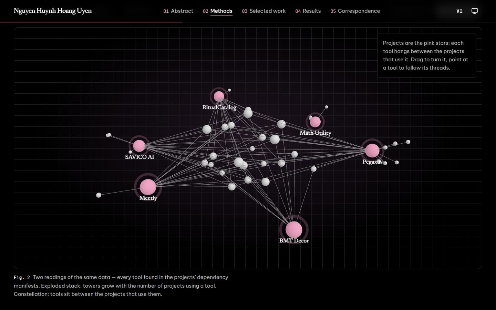
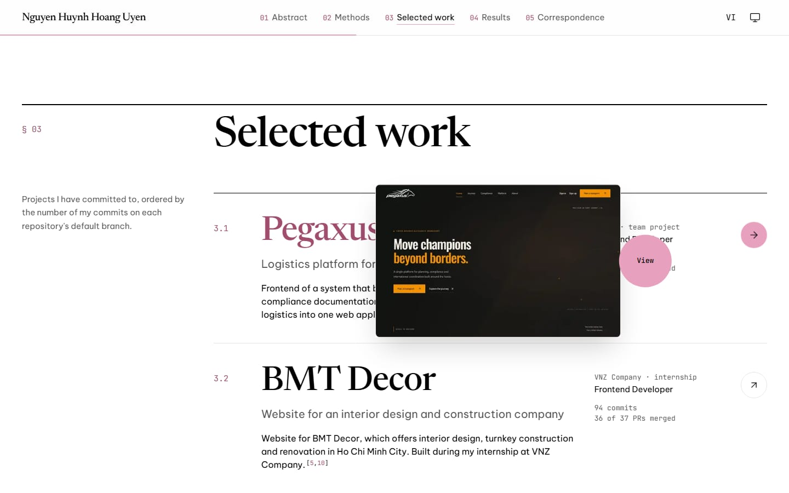

# Portfolio — Nguyen Huynh Hoang Uyen

A frontend developer's portfolio written like a research preprint: numbered sections, figures, and a
bracketed citation `[n]` on every fact. Nothing is typed in by hand — profile, commits, projects and
stack are read from the GitHub API, and each claim links back to the repository or file it came from.

**Live site:** _coming soon (Vercel)_ · **Languages:** English (`/en`) · Tiếng Việt (`/vi`) ·
**Themes:** light / dark / system


## Highlights

**Fig. 1 — Every sheet is one commit.** The hero is a scroll-driven WebGL scene. Each of the 361
commits from the past months is a sheet of paper tumbling behind the title; scroll and they fly into
place, stacking by week (left → right) and by project (front → back). Hold the mouse button to gather
them around the cursor; a giant counter tallies them mid-flight; a pink "time cursor" sweeps the
finished chart.



**Fig. 2 — Methods, the stack in 3D.** Two switchable readings of the same tool × project data,
derived from each project's `package.json` / `pom.xml`:

- **Exploded stack** — one glass slab per layer (Frontend, Styling, State & data, Backend,
  Tooling); each tool is a tower as tall as the number of projects using it. Scrolling pulls the
  layers apart.
- **Constellation** — projects are pink stars; shared tools form a core, the rest orbit the
  projects that use them, tied by threads. Drag to rotate, hover to follow a tool's threads.



**Selected work.** Six projects ranked by commit count, each with a screenshot of its live demo
(following the cursor on desktop) and a case study page: problem, approach, highlights, commits,
pull requests, languages and stack.



**Results and References.** A contribution calendar, language share, live "latest activity" (fetched
client-side through a server route so the token never reaches the browser), and a citation index
that counts where each source is cited and jumps back to it.

**Built to a quality floor.** Every animation has a `prefers-reduced-motion` fallback (static SVG /
static table); 3D scenes are lazy-loaded, paused off-screen and lighter on low-power devices;
layouts use only Tailwind's scale, `rem`, `%` and `clamp()` — no fixed pixel sizes; keyboard
focus, ARIA labels and text alternatives for every figure.

## Tech stack

| Area        | Tools                                                                            |
| ----------- | -------------------------------------------------------------------------------- |
| Framework   | Next.js 16 (App Router, Cache Components, Turbopack) · React 19 · React Compiler |
| Language    | TypeScript (strict)                                                              |
| Styling     | Tailwind CSS v4 (design tokens as CSS variables) · next-themes                   |
| 3D & motion | three.js · React Three Fiber · drei · Motion                                     |
| Data        | GitHub GraphQL + REST · Zod validation · TanStack Query (client-side only)       |
| i18n        | next-intl (locale-prefixed routes, typed message keys)                           |
| Quality     | ESLint · Prettier (+ Tailwind plugin) · Playwright (screenshots)                 |

## Getting started

Requires Node.js ≥ 20.

```bash
git clone https://github.com/uyenne06/Portfolio.git
cd Portfolio
npm install
cp .env.example .env.local   # optional: add GITHUB_TOKEN for live data
npm run dev                  # http://localhost:3000 → redirects to /en
```

Without `GITHUB_TOKEN` the site renders from the committed snapshot
`src/data/github-snapshot.json`, so it always builds — even offline or when the API is
rate-limited.

## How the data works

```
GitHub GraphQL + REST ──► fetchGitHubData()  (Zod-validated, plain TypeScript)
        │                        │
        │                        └──► scripts/sync-github.ts ──► src/data/github-snapshot.json
        ▼
getGitHubData()   'use cache' · cacheLife('hours') · cacheTag('github')
        │         no token or API error → snapshot
        ▼
feature services (projects, stack matrix, timeline, activity) ──► components (props only)
```

Pages are prerendered and refreshed at most once an hour. One GraphQL request fetches the profile,
the contribution calendar, per-repository commit timelines, languages and dependency manifests.

## Scripts

| Script                     | What it does                                                             |
| -------------------------- | ------------------------------------------------------------------------ |
| `npm run dev`              | Development server                                                       |
| `npm run build`            | Production build (prerenders `/en`, `/vi` and every case study)          |
| `npm run start`            | Serve the production build                                               |
| `npm run lint`             | ESLint (`eslint-config-next`)                                            |
| `npm run typecheck`        | Generate route types, then `tsc --noEmit`                                |
| `npm run format`           | Prettier + Tailwind class sorting                                        |
| `npm run sync:github`      | Refresh the committed snapshot from the API (needs `GITHUB_TOKEN`)       |
| `npm run capture:previews` | Screenshot each project's live demo into `public/projects/` (Playwright) |

## Environment variables

| Name                   | Secret | Purpose                                                       |
| ---------------------- | ------ | ------------------------------------------------------------- |
| `GITHUB_TOKEN`         | yes    | Read-only fine-grained token for the GitHub API (server-only) |
| `GITHUB_USERNAME`      | no     | Whose data to show (default `uyenne06`)                       |
| `NEXT_PUBLIC_SITE_URL` | no     | Canonical base URL for metadata, sitemap and Open Graph       |

Real values go in `.env.local` (git-ignored) or in the hosting provider's settings — never in the
repository. `.env.example` lists the names only.

## Project structure

```
src/
├─ app/[locale]/        routing, layouts, metadata — composition only
├─ features/            hero · about · tech-stack · projects · github-activity · contact · references
│                       (components / services / hooks / types per feature)
├─ shared/              UI primitives, layout, 3D building blocks, GitHub data layer
├─ config/              site, featured projects, references, env (Zod)
├─ i18n/                routing + messages/{en,vi}.json
└─ styles/globals.css   design tokens
```

Read more in [`docs/ARCHITECTURE.md`](docs/ARCHITECTURE.md) — folder rules, data flow, the 3D
scenes, and how to add a project or a section. Every fact on the site and its source is listed in
[`docs/github-facts.md`](docs/github-facts.md).

## Contact

[hoanguyen91011@gmail.com](mailto:hoanguyen91011@gmail.com) ·
[GitHub](https://github.com/uyenne06) ·
[LinkedIn](https://www.linkedin.com/in/nguy%E1%BB%85n-hu%E1%BB%B3nh-ho%C3%A0ng-uy%C3%AAn-7472b5353/)
